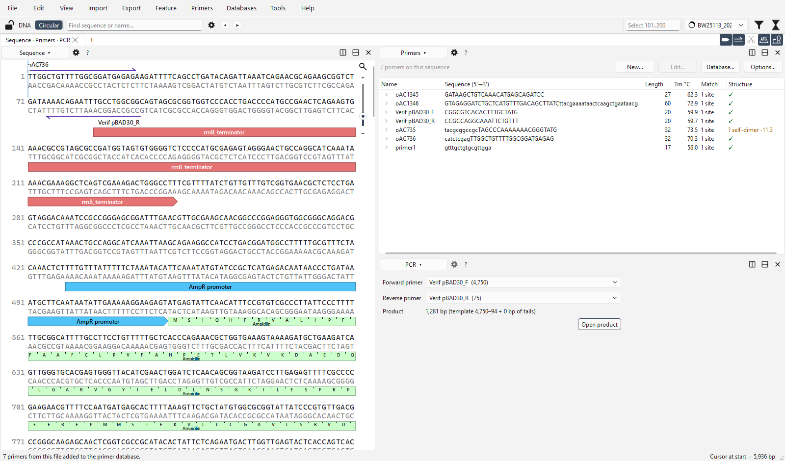
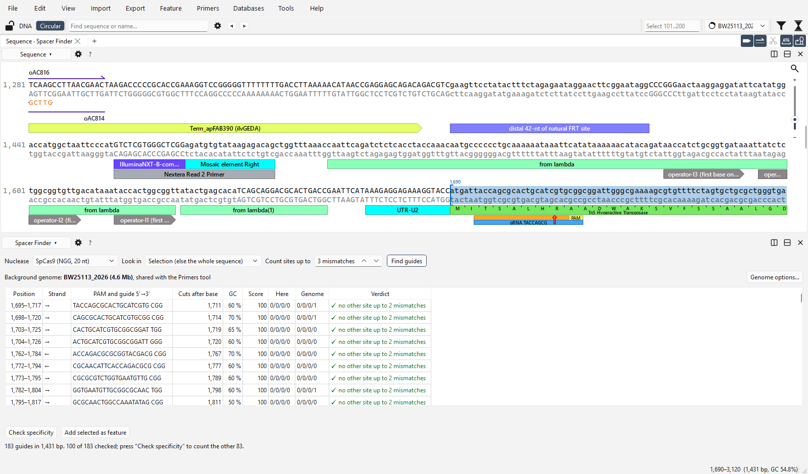
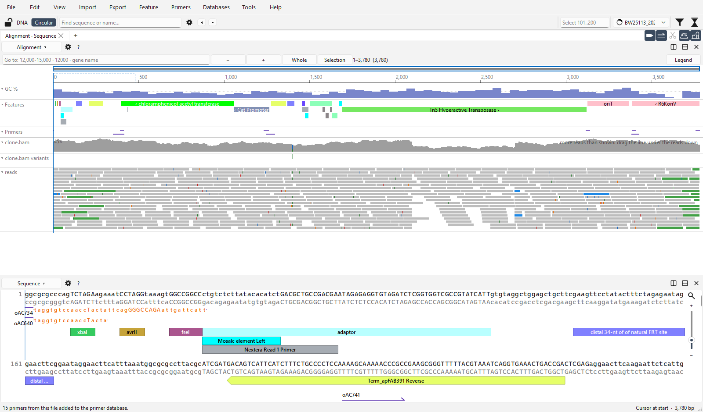
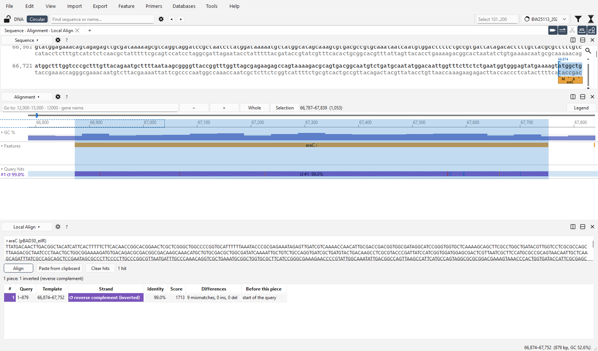
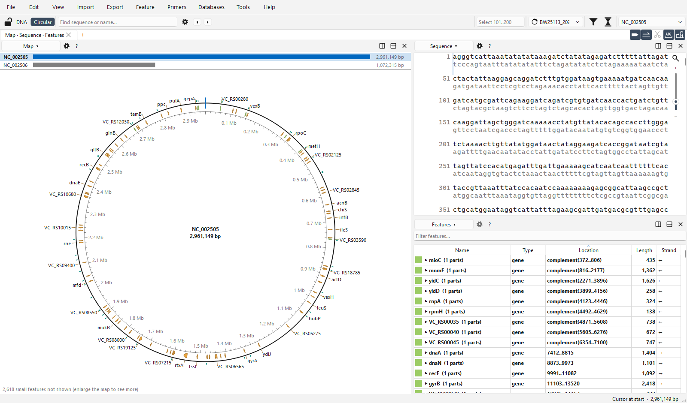

<h1 align="center">
  <picture>
    <source media="(prefers-color-scheme: dark)" srcset="docs/images/wordmark-dark.svg">
    
  </picture>
</h1>

<strong>openDNA is a free, open-source DNA sequence editor that works offline.</strong>

It opens a small plasmid or a whole genome in the same window, and your annotations stay on the right bases when you
edit. You can design primers, Cas9 guides and assemblies on your own computer, and nothing leaves it.

## Downloads

| System | Requirements | Download |
|---|---|---|
| **Windows** | Windows 10 or 11, 64-bit (x86-64). No installer, no administrator rights, no Python. | **[oDNA_beta.exe](https://github.com/OpenDNA-project/openDNA/releases/latest/download/oDNA_beta.exe)** (one file, about 42 MB) or [as a folder](https://github.com/OpenDNA-project/openDNA/releases/latest/download/oDNA_beta-folder.zip), to replace the Qt libraries yourself |
| **macOS, Apple Silicon** | macOS 14 Sonoma or later, on a Mac with an M1 chip or later (Apple menu → *About This Mac* shows **Chip**). | **[oDNA_beta-macos-arm64.zip](https://github.com/OpenDNA-project/openDNA/releases/latest/download/oDNA_beta-macos-arm64.zip)** (about 31 MB): unzip, move openDNA to Applications |
| **macOS, Intel** | macOS 14 Sonoma or later, on an Intel Mac (*About This Mac* shows **Processor**). | **[oDNA_beta-macos-x86_64.zip](https://github.com/OpenDNA-project/openDNA/releases/latest/download/oDNA_beta-macos-x86_64.zip)** (about 32 MB): unzip, move openDNA to Applications |
| **Linux** | 64-bit (x86-64) with glibc 2.35 or newer: Ubuntu 22.04+, Debian 12+, Fedora 36+, Linux Mint 21+ (`ldd --version` shows it; not RHEL / Rocky 9). A desktop (X11 or Wayland) with OpenGL and fontconfig. | **[oDNA_beta-linux-x86_64.tar.gz](https://github.com/OpenDNA-project/openDNA/releases/latest/download/oDNA_beta-linux-x86_64.tar.gz)** (about 74 MB): `tar -xzf oDNA_beta-linux-x86_64.tar.gz`, then run `openDNA/openDNA` |

Older systems, Windows on ARM, or anything else: [run from source](CONTRIBUTING.md#run-from-source) (Python 3.11+ and Rust).
Read mapping (optional) also needs bwa, samtools and minimap2: on Windows through WSL (*Tools → Install Mapping Tools*).

Every download has a `.sha256` file beside it on the [releases page](https://github.com/OpenDNA-project/openDNA/releases).

> **This is a beta (0.5), so keep copies of your files.** The programs are not signed, which is why your system will warn you the
> first time. Check the SHA-256 against the release notes, then click *More info* → *Run anyway* on Windows, or right-click openDNA
> → *Open* → *Open* on macOS ([SECURITY.md](SECURITY.md)). If you are new, the [tutorial](docs/TUTORIAL.md) takes about 15 minutes.

## Editing

You can insert, delete, replace, paste, rotate or reverse-complement a sequence, and every feature stays on the bases it belongs
to. That includes `join` and `complement` features, fuzzy ends and features that cross the origin. The tests make hundreds of random
edits and check every base against an independent model.

There is also [unlimited undo with a plain-English History](docs/USER_GUIDE.md) ("Inserted 5 bp at 301: …") and a
[search bar](docs/USER_GUIDE.md) that finds DNA on both strands, with IUPAC codes and fuzzy matches. It also finds protein motifs in
six frames, feature names and primers. Other tools are a [protein view with 3D structures](docs/USER_GUIDE.md) from RCSB PDB,
AlphaFold DB or ESMFold, a [construct check-up that shows transcription units](docs/USER_GUIDE.md), and
[ORF detection](docs/USER_GUIDE.md). The program has light and dark themes, autosave and crash recovery. It reads and writes
GenBank, and reads `.dna` and FASTA.

## Assembly

Choose your fragments and openDNA designs the primers, then shows each junction on its own card with the exact joining bases,
their length, Tm and GC, and whether the circle closes. In the picture, pBAD30 is rebuilt from its own backbone and its eilR insert,
which gives two junctions and four oligos.

[Golden Gate](docs/USER_GUIDE.md) is supported too, with overhang sets checked against published high-fidelity data, as is
[Sidewinder](docs/USER_GUIDE.md).

## Primers and PCR

The primer list covers the primers in your file and in your own database, with their Tm, hairpins, self-dimers, binding sites and
mismatches. Pick any two and the PCR product is shown. In the picture, the verification primers of pBAD30 give a 1,281 bp product,
and one of them is flagged for a self-dimer.

You can also [design primers for a selection](docs/USER_GUIDE.md), [look for other binding sites](docs/USER_GUIDE.md) in the sequence
or in a background genome, and run a [restriction digest with a virtual gel](docs/USER_GUIDE.md).

## Cas9 guides

The Spacer Finder lists the guides in a gene or a whole plasmid, with each cut site, its GC content, a checklist score (a rule of
thumb, not a trained model) and the other sites it matches, both in this sequence and in a background genome. If you add a guide as a
feature, it is drawn with its protospacer, PAM and cut.

[SaCas9 and Cas12a](docs/USER_GUIDE.md) are supported as well, and any guide has its own [off-target list](docs/USER_GUIDE.md).

## Read mapping

The alignment view is similar to IGV. It shows coverage, variants, mismatches and the reads themselves, next to the features and
primers of the same sequence. The picture uses simulated Illumina reads from a mixed colony, and the dip near 1,900 is a deletion
carried by part of the population.

Reads can be [mapped with bwa or minimap2](docs/USER_GUIDE.md) (through WSL on Windows), and
[GFF / GTF / BED / VCF / BAM tracks](docs/USER_GUIDE.md) can be loaded.

## Local alignment

Local Align finds one sequence inside another with a seed-and-extend search that allows gaps and covers both strands. The hits are
drawn as a track. It is not BLAST and it needs no server. In the picture, the araC gene of pBAD30 is found on the *E. coli*
chromosome at 99.0 % identity, inverted, and its 9 mismatches are listed.

The [background genome](docs/USER_GUIDE.md) is shared by the primer and guide tools, and you can
[import from NCBI](docs/USER_GUIDE.md) by accession or by search.

## Whole genomes

When a file has several records, openDNA lists them and a click opens the one you want. The picture shows both chromosomes of
*Vibrio cholerae* N16961 (2.96 Mb and 1.07 Mb) from a single GenBank file. A 4.6 Mb genome opens in the same window as a 5 kb
plasmid.

[Multi-record GenBank and FASTA](docs/USER_GUIDE.md) files work this way, you can search every record at once, and
[whole genomes can be downloaded from NCBI](docs/USER_GUIDE.md).

## Privacy

openDNA works offline. It only goes online for features you choose to use, namely NCBI import, 3D structure lookup and the update
check, and it tells you before it does. [PRIVACY.md](PRIVACY.md) lists exactly what is sent and where settings and caches are stored.

## Documentation

| | |
|---|---|
| [docs/TUTORIAL.md](docs/TUTORIAL.md) | Hands-on walk-through: edit, annotate, design primers, assemble |
| [docs/USER_GUIDE.md](docs/USER_GUIDE.md) | Every feature, the Python API, the primer database, read mapping |
| [PRIVACY.md](PRIVACY.md) | What is sent over the network, what is stored where, how to delete it |
| [SECURITY.md](SECURITY.md) | Reporting a vulnerability; the unsigned exe and how to verify it |
| [CONTRIBUTING.md](CONTRIBUTING.md) | Bugs, feature requests, running from source, building, the tests |
| [docs/TESTING.md](docs/TESTING.md) | The test plan and its progress |
| [THIRD_PARTY_NOTICES.md](THIRD_PARTY_NOTICES.md) | The components openDNA is built with and their licences |
| Help > Citations | What each panel is based on, and the packages used |

## Report a bug, ask for a feature

You can **[open an issue](https://github.com/OpenDNA-project/openDNA/issues/new/choose)**, or use *Help > Report a Problem* in the
program. That fills in the form with the version and the last log lines; sequences, file names and paths are blanked out first, and
nothing is sent until you press Submit. For security problems, follow [SECURITY.md](SECURITY.md) instead of opening a public issue.

If you would like to help with the code, [CONTRIBUTING.md](CONTRIBUTING.md) explains how to run it from source, build the exe and run
the tests.

## Licence

Copyright (C) 2026 Antoine Champie. openDNA is free software under the **GNU Affero General Public License v3.0**
([LICENSE](LICENSE)): you may use, study and change it, but anything you distribute, or run as a network service, built on it must be
offered under the same licence with its source. Third-party components keep their own licences, including Qt under the LGPL:
see [THIRD_PARTY_NOTICES.md](THIRD_PARTY_NOTICES.md).

**Forks are welcome, under another name**: the names "openDNA" and "oDNA" and the logo stay with this project
([TRADEMARKS.md](TRADEMARKS.md)).

openDNA builds on PySide6 / Qt, PyO3, `gb-io`, `noodles`, `quick-xml` and 3Dmol.js. The methods it implements are cited in
**Help > Citations**: Gibson et al. 2009, Engler et al. 2008, Potapov et al. 2018, SantaLucia 1998, the Cas9 / Cas12a papers and the
Sidewinder method (Robinson et al., Nature 2026).
