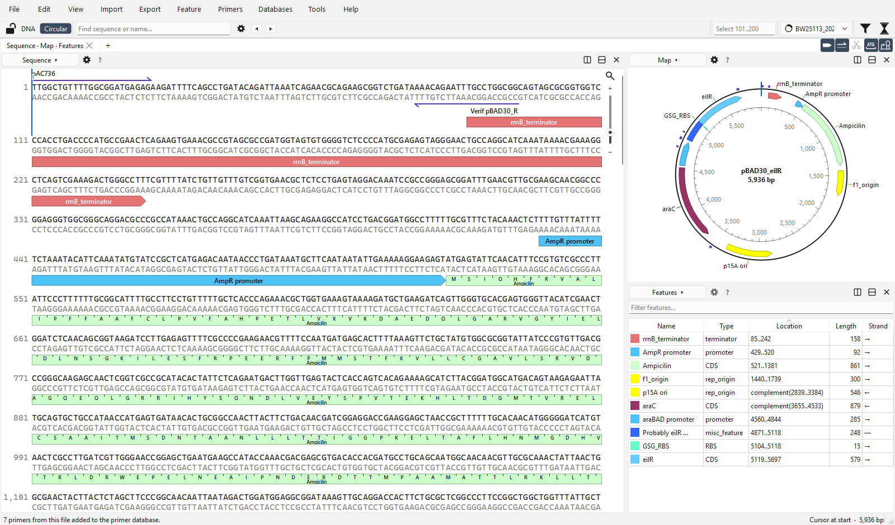
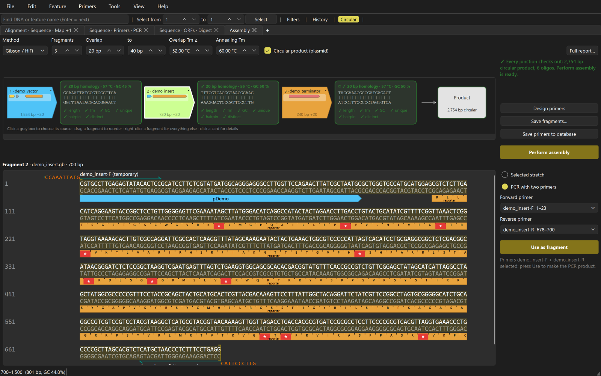
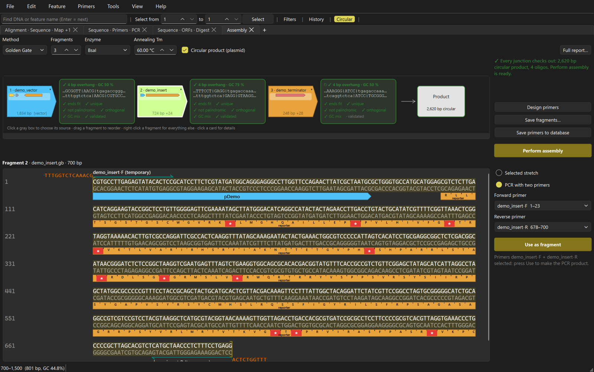

<h1 align="center">
  <picture>
    <source media="(prefers-color-scheme: dark)" srcset="docs/images/wordmark-dark.svg">
    
  </picture>
</h1>

**A free, offline DNA editor for Windows: plasmids and genomes, primers, PCR, Cas9 / Cas12a guides, digests, and Gibson, Golden Gate and Sidewinder
assembly design.** Edit a sequence and every annotation stays on the right bases, design primers, and plan an assembly with the exact joining bases,
Tm and checks of every junction in front of you. The core is written in Rust (`core/`), the interface in Python + PySide6 (`app/`).

> **Version 0.5** ([Releases](https://github.com/OpenDNA-project/openDNA/releases)). openDNA is free software; the official download is
> github.com/OpenDNA-project/openDNA.

> **Status: ready for internal use and testing.** It works and has an automated test suite, but few people have used it yet. Keep copies of your files: openDNA
> never modifies a `.dna` file (edits are saved as GenBank), but treat any editor with care. The test plan in
> [docs/TESTING.md](docs/TESTING.md) is nearly complete, not complete (two items are still open), and some tests need real files that are not in this repository.
> It comes with no warranty. Licensed under the AGPL-3.0: see [Licence](#licence).



## Download and run (Windows 10 or 11, 64-bit)

1. Go to **[github.com/OpenDNA-project/openDNA/releases](https://github.com/OpenDNA-project/openDNA/releases)** and download `oDNA_beta.exe` from the
   latest release. Nothing needs to be installed; it is one file, it runs without Python. (`oDNA_beta-folder.zip` is the same program as a folder, for people
   who want to replace the Qt libraries it uses; see [THIRD_PARTY_NOTICES.md](THIRD_PARTY_NOTICES.md). It does not update itself.)
2. **Windows SmartScreen will warn you** ("Windows protected your PC"), because the exe is not code-signed (a certificate costs money). That is expected for this test
   version. Check the file first, then click *More info* and *Run anyway*.
3. **Check the SHA-256** of what you downloaded against the value in the release notes (letter for letter):

   ```powershell
   Get-FileHash .\oDNA_beta.exe -Algorithm SHA256
   ```

   If it differs, do not run it and tell us (see [SECURITY.md](SECURITY.md)).
4. Open a `.gb`, `.fasta` or `.dna` file with File > Open (Ctrl+O), or start with the [tutorial](docs/TUTORIAL.md) (15 minutes; it uses the small demo
   files in `demo/` of this repository).

openDNA is offline. It contacts the internet only for the features you choose to use (NCBI import, 3D structure lookup, the update check): see **[PRIVACY.md](PRIVACY.md)**
for exactly what is sent and where settings and caches are stored.

## Report a bug, ask for a feature

Use **GitHub Issues**: **[new issue (choose a template)](https://github.com/OpenDNA-project/openDNA/issues/new/choose)**. In the program, *Help > Report a Problem*
opens the same form already filled with the version and the last log lines (sequences, file names and paths are blanked out first, and nothing is sent until you press
Submit on GitHub). A short guide for people who want to help is in [CONTRIBUTING.md](CONTRIBUTING.md). Security problems: [SECURITY.md](SECURITY.md), not a public issue.

## What it does

- **Views:** sequence view (both strands, translations, features, primers, enzyme sites), circular / linear map, feature table, and an IGV-like alignment view for
  genomes with GFF / GTF / BED / VCF / BAM tracks. A bacterial genome opens in the same window as a 5 kb plasmid. Several views open as tabs and panes.
- **Features and editing:** insert, delete, replace, paste, rotate, reverse-complement, make a circle linear. Features (including `join`, `complement`, fuzzy and
  origin-crossing ones) are designed to stay on the same bases through every edit; this is checked by tests that make hundreds of random edits and compare each
  base against an independent model.
- **Unlimited undo with a plain-English History** ("Inserted 5 bp at 301: ..."); features and primers are steps in it too.
- **Primers:** a primer database, binding sites with mismatches and tails, Tm, hairpins and dimers, PCR products, primer design for a selection, and a check for
  other binding sites in the sequence or a background genome.
- **Cas9 / Cas12a guide finder:** every SpCas9 / SaCas9 / Cas12a guide with its cut site and a checklist score (a rule of thumb, not a trained model), and the other
  sites each one matches.
- **Restriction digest** with a virtual gel (typical ladder sets), and the cuts drawn on both strands.
- **Assembly design (Gibson / HiFi, Golden Gate, Sidewinder)**, described below.
- **Local Align:** a seed-and-extend search with gaps, both strands (it is not BLAST), with the hits drawn as a track.
- **Protein view and 3D structure:** translated CDS with mass, pI and charge; a 3D structure from RCSB PDB, AlphaFold DB, ESMFold or your own local command (the window
  tells you before anything leaves your computer).
- **Import from NCBI** (File > Import from NCBI): GenBank / RefSeq nucleotide, genome and protein records by accession or search.
- **Search bar:** DNA on both strands, IUPAC codes, fuzzy matches, protein motifs in six frames, feature names and details, primers, enzyme sites; in the selection or
  in a whole multi-sequence file.
- **Reads and variants:** map reads with bwa or minimap2 (on Windows through WSL; see [docs/USER_GUIDE.md](docs/USER_GUIDE.md)), see coverage and mismatches, list variants.
- **Other:** ORF finder, common-feature detection, light and dark themes, autosave and crash recovery.
- **Formats:** GenBank (read, write), `.dna` (read only; saved as GenBank), FASTA.

## The Assembly tab

*Tools > Assembly* opens a tab (not a window, not a pane) for **Gibson / HiFi**, **Golden Gate** (BsaI, BsmBI, BbsI, SapI) and **Sidewinder**:



1. Choose the method and the number of fragments (1 to 12). Each fragment is a gray box.
2. Click a box and take its DNA from an open file, a recent file or a file you browse to; select a stretch in the
   editor's own sequence view, or click two primers to use their PCR product, tails included.
3. The junctions are checked at once on the **real ends** of the fragments. Each card shows the joining bases on both
   strands, Tm and GC, and its checks (length, Tm, unique in the product, hairpin...). Red means the ends do not fit.
4. **Design primers** designs new primers that carry what the method needs (an overlap tail for Gibson, a site +
   spacer + overhang for Golden Gate) and draws them on each fragment's sequence, tails included.
5. When every junction checks out, **Perform assembly** makes the **exact** sequence you would get, features in place, and
   **Save fragments** writes each PCR product.



Golden Gate overhangs are checked for repeats, palindromes, reverse complements and near-matches, and compared with the 25
high-fidelity overhangs of Potapov et al. (2018); the designer prefers that set. See Help > Citations for the references. The full
ligation-fidelity matrix is not included, so that check is a rule of thumb, not a measured fidelity. The Sidewinder method (Robinson et al., Nature 2026) is
implemented in a simplified form: check its strand layout against the paper before ordering oligos. The screenshots use made-up demo sequences.

## Run from source

For developers and anyone who wants to try the latest code. Windows is the primary platform.

1. Install [Rust](https://rustup.rs/), the Visual Studio C++ Build Tools and [Miniconda](https://docs.conda.io/en/latest/miniconda.html).
2. Build and run:

```powershell
conda create -n opendna python=3.13
conda activate opendna
pip install -r requirements.txt
maturin develop -m core/Cargo.toml --release
python app/main.py demo/demo_insert.gb
```

(The three demo files are already in `demo/`; `python scripts/make_demo_files.py` writes them again, identical.)

Use the dedicated `opendna` environment, **not** conda `base`: base ships ICU 73 in `Library\bin`, which
conda's Python puts on the DLL path; PySide6's `Qt6Core.dll` then loads it instead of Windows' ICU and fails
with "DLL load failed ... The specified procedure could not be found".

## Build from source

Standalone `dist\openDNA.exe` (one file, about 39 MB, runs on a PC without Python): after `pip install -r requirements-dev.txt` and
`maturin develop -m core/Cargo.toml --release`, run

```powershell
powershell -NoProfile -ExecutionPolicy Bypass -File scripts/build_exe.ps1
```

It builds from the committed recipe `packaging/openDNA.spec` (which lists the bundled data files, icon and version), prints the size and
SHA-256, and smoke-tests the exe: it starts it, opens `demo/demo_vector.gb` and checks that it stays alive (`-NoSmoke` skips the test).
It also builds `dist\openDNA-folder.zip`, the same program as a folder with the Qt files replaceable (`-NoFolder` skips it).
The release workflow publishes both under the name in `app/project.py` (`EXE_NAME`: `oDNA_beta.exe`, `oDNA_beta-folder.zip`).
Rebuild the Rust module after every change to `core/`. Releases are built from a `v*` tag by `.github/workflows/release.yml` into a draft
GitHub release; see [docs/PUBLISHING.md](docs/PUBLISHING.md).

## Tests

```powershell
cd core; cargo test; cd ..     # Rust (needs PYO3_PYTHON pointing at the opendna env's python.exe)
pytest -q tests                # Python (needs the module built and pip install -r requirements-dev.txt)
```

`tests/test_real_files.py` and `tests/test_gui.py` and some others use your own `.gb` / `.dna` files in the repository root (not in git) and skip
those tests if the files are absent. The same fast checks also run inside the app: Help > Troubleshooting > Self-Test.
[docs/TESTING.md](docs/TESTING.md) is the test plan: what is covered and what is still missing.

## Documentation

| | |
|---|---|
| [docs/TUTORIAL.md](docs/TUTORIAL.md) | Hands-on walk-through: edit, annotate, design primers, assemble |
| [docs/USER_GUIDE.md](docs/USER_GUIDE.md) | Every feature, the Python API, the primer database, read mapping |
| [PRIVACY.md](PRIVACY.md) | What is sent over the network, what is stored where, how to delete it |
| [SECURITY.md](SECURITY.md) | Reporting a vulnerability; the unsigned exe and how to verify it |
| [CONTRIBUTING.md](CONTRIBUTING.md) | Bugs, feature requests, running the tests, code style |
| [docs/TESTING.md](docs/TESTING.md) | The test plan and its progress |
| [docs/RUST_PRIMER.md](docs/RUST_PRIMER.md) | A guide to reading the Rust code, for people who know Python |
| [THIRD_PARTY_NOTICES.md](THIRD_PARTY_NOTICES.md) | The components openDNA is built with and their licences |
| Help > Citations | What each panel is based on, and the packages used |

## Licence

Copyright (C) 2026 Antoine Champie. openDNA is free software under the **GNU Affero General Public License v3.0**
([LICENSE](LICENSE)): you may use, study and change it, but anything you distribute, or run as a network service, built on
it must be offered under the same licence with its source. Third-party components keep their own licences:
see [THIRD_PARTY_NOTICES.md](THIRD_PARTY_NOTICES.md). The Windows exe contains Qt, which is under the LGPL: how to get its source and
use another Qt is explained there.

**Forks are welcome, under another name.** The licence lets anyone share a modified version; the names "openDNA" and
"oDNA" and the logo stay with this project, so a modified version must use a name and an icon of its own and must not present
itself as the official tool. What is allowed without asking is in [TRADEMARKS.md](TRADEMARKS.md).

Author: Antoine Champie.

## Credits

openDNA builds on PySide6 / Qt (LGPL), PyO3, `gb-io` (MIT, a patched copy lives in `core/vendor/gb-io`), `noodles`,
`quick-xml` and 3Dmol.js (BSD-3-Clause). The methods it implements are cited in **Help > Citations**: Gibson et al. 2009, Engler et al. 2008,
Potapov et al. 2018 (overhang data), SantaLucia 1998 (Tm), the Cas9 / Cas12a papers, and the Sidewinder method
(Robinson et al., Nature 2026).
